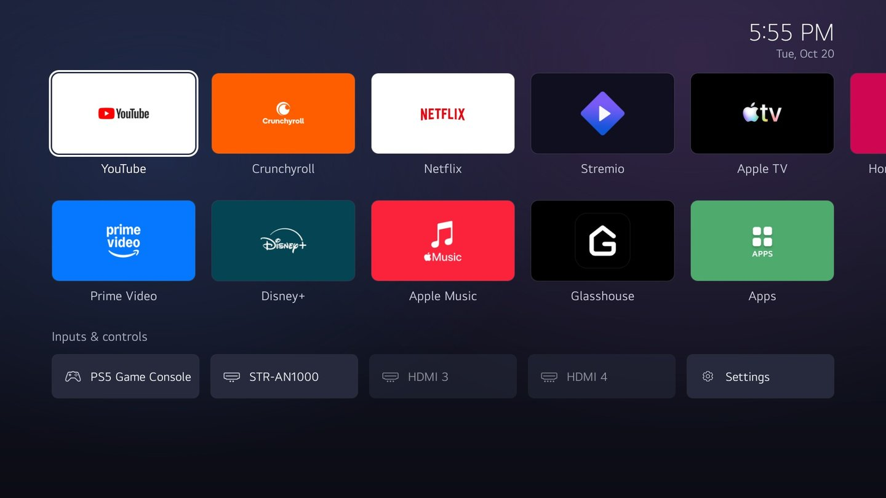
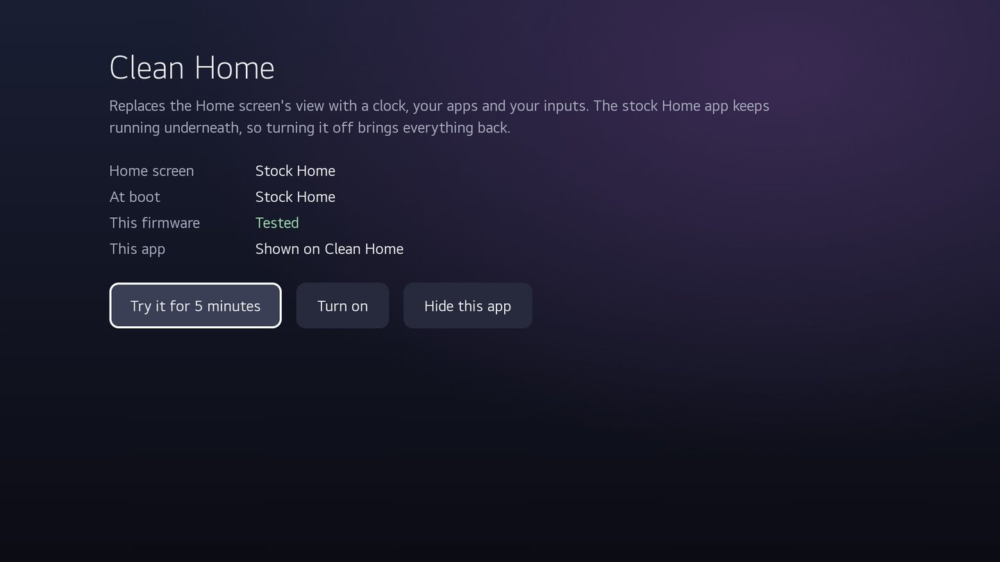

# Clean Home for LG webOS

A quiet Home screen for rooted LG TVs: the clock, your apps and your inputs. No ads, no rows of recommendations, no animation.



Clean Home doesn't replace LG's Home app. It swaps in a different view (`MainView.qml`) with a bind mount, so the stock Home process keeps doing its job: it still handles the Home key, launching apps and waking the TV. Turning Clean Home off, or a boot in the Homebrew Channel's failsafe mode, brings the stock screen back.

## What you get

- Clock and date in the corner.
- Your apps in two rows, in the same order as the stock Home and its Edit App List. Apps fill pages of five columns, top row first; the last page splits its apps evenly between the two rows. The rows scroll sideways one column at a time; the next column peeks in at the right edge.
- A row with your HDMI inputs, using the names you gave them on the TV (unplugged ones are dimmed), plus Settings.
- Focus goes back to the first app every time Home opens. Number keys 1–9 open the first nine apps, and 0 opens the Clean Home app.
- To move an app, hold OK on it for 0.7 s (it gets a blue ring and arrows), move it with the arrows, then press OK or Back. The new order is saved in the TV's own app list, so stock Home uses it too.

Hidden by default: Art Gallery, Media Player, Sports Alert, Who.Where.What?, Alexa, LG Channels, Home Dashboard, Room to Room Share, AmazOff and the old HBO Max.

## Requirements

- An LG TV rooted with the [Homebrew Channel](https://github.com/webosbrew/webos-homebrew-channel), with "Block system updates" on so the firmware stays the same. See [webosbrew.org](https://www.webosbrew.org/) for how to root your model.
- Firmware that passes the compatibility check (see [Firmware](#firmware)). The app runs it for you.

Tested on:

| Model | Firmware | webOS |
| --- | --- | --- |
| OLED65C1PUB | 03.53.45 | 6.5.3 |

Other webOS 6 TVs (2021 models) may work. webOS 7 and later probably have a different Home app. If Clean Home works on your TV, please open a pull request that adds it to this table.

## Install

### With the app

1. Download `clean-home.ipk` from the [latest release](https://github.com/kiri11/webos-clean-home/releases/latest).
2. Install it with [webOS Dev Manager](https://github.com/webosbrew/dev-manager-desktop), or from a root shell on the TV (SSH or telnet). Press Ctrl+C once it says `installed`:

   ```sh
   curl -L -o /tmp/clean-home.ipk https://github.com/kiri11/webos-clean-home/releases/latest/download/clean-home.ipk
   luna-send -i luna://com.webos.appInstallService/dev/install '{"id":"io.github.kiri11.cleanhome","ipkUrl":"/tmp/clean-home.ipk","subscribe":true}'
   ```

3. Open **Clean Home** from your apps and choose **Try it for 5 minutes**, then press Home. If you like it, open the app again and choose **Turn on**: it mounts the view now and at every boot.



The app shows only the buttons that make sense right now: **Try** and **Turn on** while stock Home is showing, **Turn on** and **Back to stock now** during a trial, **Turn off** once it's on, and **Apply update** after you install a new version. If the TV can't run Clean Home, the app says why and doesn't offer to turn it on.

**Hide this app** removes the app's tile from Clean Home. Press 0 on the Home screen to open it again. Stock Home always shows it, so you can still reach it after turning Clean Home off.

The app runs everything through the Homebrew Channel's root service.

### From a computer

`tools/cleanhome.py` needs only Python 3.9+. It talks to the TV as `root` over SSH when key login works (OpenSSH's `ssh` on your PATH, your key in `/home/root/.ssh/authorized_keys`), otherwise over telnet (turn it on in the Homebrew Channel's settings):

```sh
python tools/cleanhome.py --host 192.168.1.50 push           # upload clean-home/ to the copy in use
python tools/cleanhome.py --host 192.168.1.50 home trial 600 # mount for 10 minutes, then roll back by itself
python tools/cleanhome.py --host 192.168.1.50 home enable    # mount now and at every boot
python tools/cleanhome.py --host 192.168.1.50 shot home.jpg  # screenshot
```

You can also set `LGTV_HOST` instead of passing `--host`. `push` and `home` work on the copy in use: the one the boot hook runs, else the installed app's, else `/media/developer/clean-home`. So on a TV with the app they act on the app's files, and `push` overwrites them until the app is reinstalled; `push DIR` uploads somewhere else.

## Turn it off or uninstall

Choose **Turn off** in the app, or run `clean-home.sh disable`. That removes the boot hook and brings stock Home back right away. Then you can uninstall the app. If you uninstall it first, the view stays until the next reboot and stock Home comes back after that.

All commands of `clean-home/clean-home.sh` (run it as root on the TV):

| Command | What it does |
| --- | --- |
| `status` | Shows whether the view is mounted, the boot hook, the compatibility check's result and the TV model |
| `trial SECONDS` | Mounts the view and rolls back by itself after SECONDS |
| `keep` | Cancels a trial's rollback, until the next reboot |
| `enable` | Mounts now and adds the boot hook `/var/lib/webosbrew/init.d/60-clean-home` |
| `disable` | Removes the boot hook and goes back to stock Home |
| `rollback` | Goes back to stock Home now (the boot hook mounts the view again on the next boot) |
| `mount`, `remount` | Mounts or reloads the view without touching the boot hook |
| `hide-app`, `show-app` | Hides or shows the Clean Home app's tile on Clean Home |
| `check` | Runs the compatibility check |

Events go to `/media/developer/clean-home/clean-home.log`.

## Settings

An optional `/media/developer/clean-home/config.json` changes which apps are hidden and which come first:

```json
{"hide": ["com.webos.app.igallery"], "order": ["netflix", "youtube.leanback.v4"]}
```

`hide` replaces the default hidden list. `order` puts those apps first; the rest follow in the TV's order, and apps listed in `order` can't be moved with the remote. Changes apply the next time Home opens.

## Firmware

Before it mounts the view (Try, Turn on, Apply update), `clean-home.sh` checks that the TV's Home app still works the way the clean view expects. It reads the rest of LG's Home code and confirms that:

- every member of the main view that Home calls (`mainView.editMenu`, `mainView.startEdit()` and so on) exists in the clean view;
- everything the clean view uses from Home still exists: `uiController.homeShown`, `systemProperties.launchPoints`, the states `main`, `hidden`, `half`, `sub` and `editMenu`, and the launch point and input fields;
- `launchApp` still takes five arguments and `moveLaunchPoint` two;
- `GlobalStyle.qml` and QtGraphicalEffects are there.

If anything is missing, it leaves stock Home alone and says what changed. The result is cached until the firmware or Clean Home changes.

The check catches renamed or removed parts, but it can't prove that everything behaves the same. On a TV that isn't in the table above, start with a trial: it goes back to stock by itself.

**Turn on** also saves a fingerprint of this TV's Home: the SHA-256 of the Home binary and of the stock `MainView.qml` and `MainView_WEE.qml`. At boot the view is mounted only if the fingerprint still matches. After a firmware update, stock Home comes back until you choose **Turn on** again, which runs the check on the new firmware.

## How it works

LG's Home (`com.webos.app.home`) is a native Qt 5 app whose UI is QML. Its `UIController.qml` loads `qml/UserInterfaceLayer/Containers/MainView.qml` (`MainView_WEE.qml` in some regions). Clean Home bind-mounts its own `MainView.qml` over both files. The rest of Home still calls into the view, so the clean view keeps those properties, signals and functions as small stand-ins and draws its own UI from Home's app list, input list and launch service.

At boot, Home is restored from a CRIU snapshot taken before its main view loads, so it reads the mounted file the first time it is shown. After mounting, the script marks the temporary snapshot invalid and restarts Home, so the new view shows up right away. The persistent snapshot in `/mnt/lg/cmn_data/checkpoint` is left alone.

The Homebrew Channel runs the boot hook early in startup. If the previous boot failed, its failsafe mode skips hooks and stock Home comes back.

## Building

```sh
python tools/build-ipk.py    # dist/io.github.kiri11.cleanhome_<version>_all.ipk and a Homebrew Channel manifest
python tools/cleanhome.py --host 192.168.1.50 install dist/io.github.kiri11.cleanhome_1.0.1_all.ipk
```

`build-ipk.py` needs only Python 3. The version is `appinfo.json`'s major and minor plus the number of commits, so every push to `main` builds a new package and publishes it as a GitHub release.

## License

[MIT](LICENSE). Not affiliated with LG Electronics; webOS and LG are their trademarks. This project contains no LG code: the clean view uses the names of LG's properties and functions only so that the stock Home app can talk to it.
